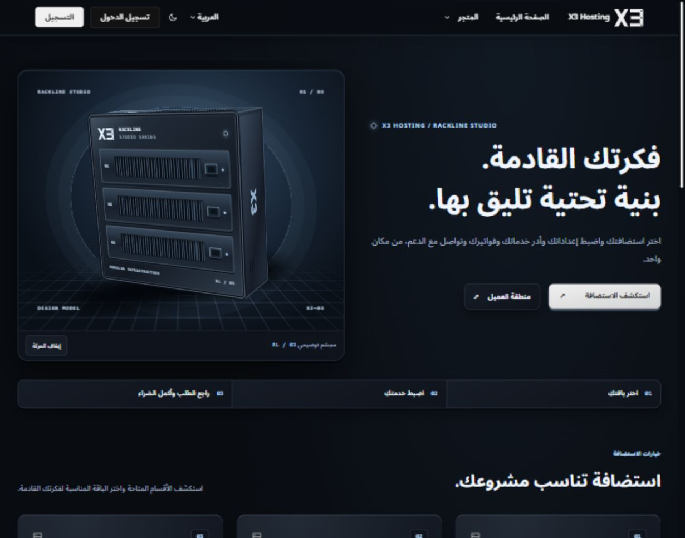
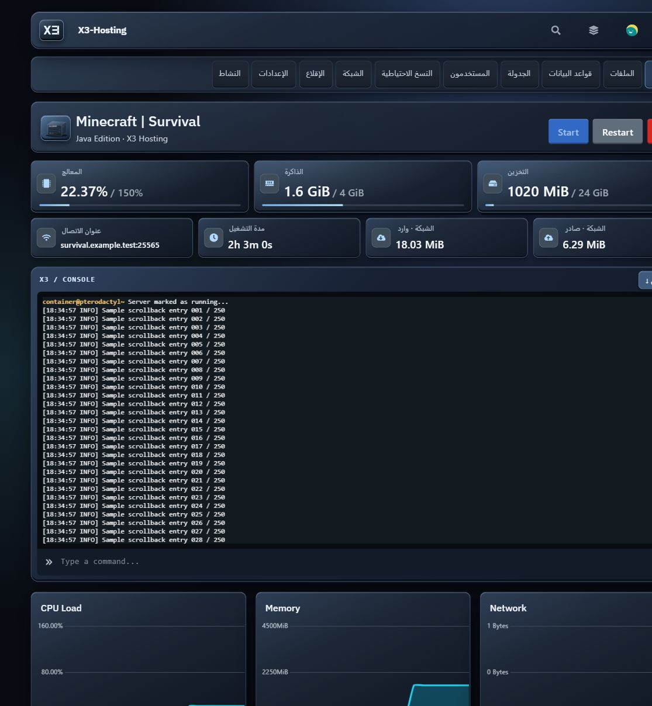
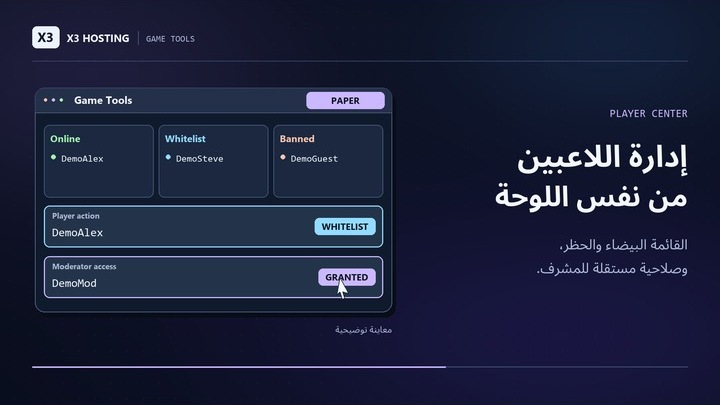
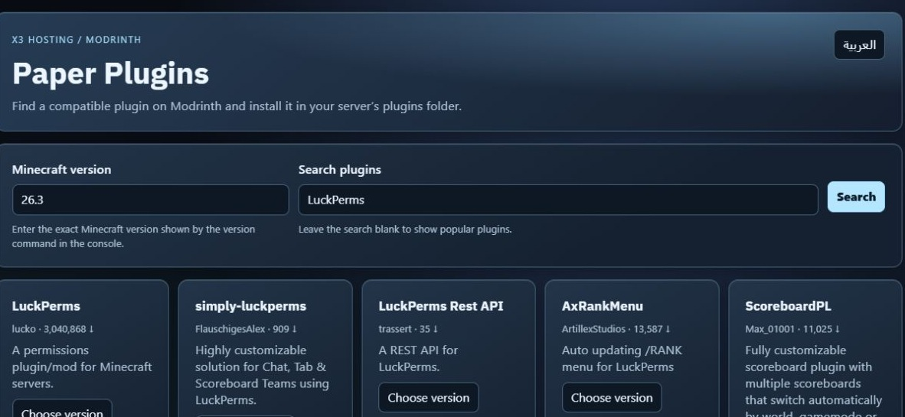
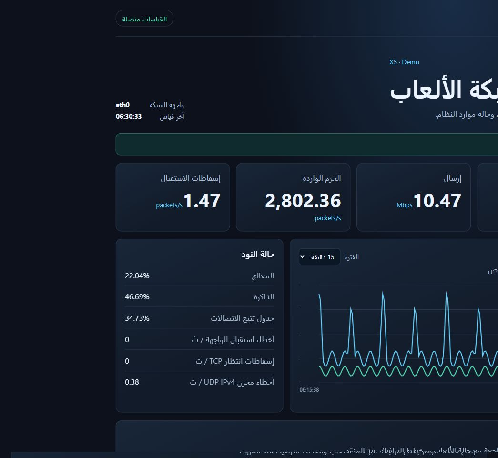

# معرض معاينات X3 Hosting

صور الواجهات التوضيحية تستخدم بيانات تجريبية. لقطة كتالوج Modrinth تبيّن مثال بحث عن بلوقن عام.

## Paymenter

[الرئيسية بالعربي](../paymenter/studio/previews/X3-Studio-3D-home-ar.jpg) · [الرئيسية بالإنجليزي](../paymenter/studio/previews/X3-Studio-3D-home-en.jpg) · [لوحة العميل](../paymenter/studio/previews/X3-Studio-3D-dashboard-ar.jpg) · [الشراء على الهاتف](previews/paymenter-purchase-mobile.jpg) · [الفاتورة](previews/paymenter-invoice.jpg) · [التذاكر](previews/paymenter-ticket.jpg) · [ويدجت Discord](previews/paymenter-discord-demo.jpg)

## Pterodactyl Rackline Glass

[السيرفرات](previews/rackline-dashboard.png) · [الهيدر](../pterodactyl/glass/previews/header.png) · [البحث](../pterodactyl/glass/previews/search.png)

## Game Tools وPaper Plugins

[Node.js](previews/node-demo.jpg) · [Python](previews/python-demo.jpg) · [رفع البلوقن](previews/paper-sync-demo.jpg) · [مراجعة الإعدادات](previews/game-settings-demo.jpg) · [إدارة اللاعبين](previews/players-demo.jpg)

## أدوات الإدارة

[معاينة عدادات الجدار](previews/firewall-demo.jpg)
